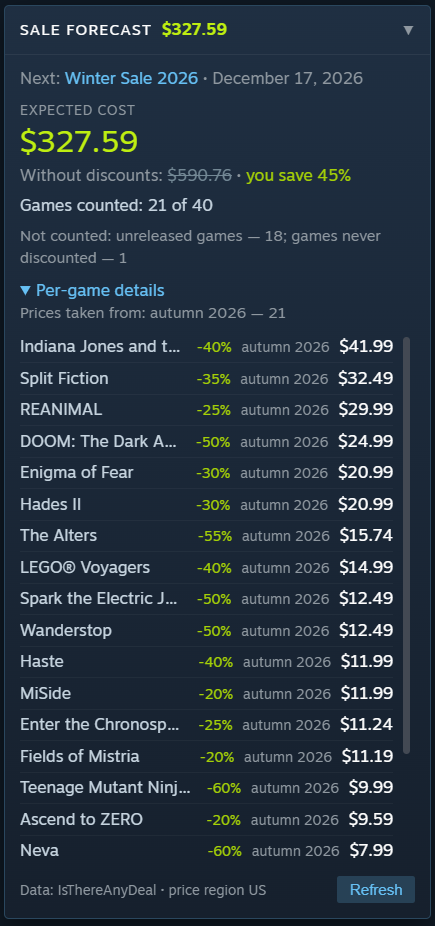

# Wishlist Sale Forecast

Плагин для [Millennium](https://steambrew.app/) (клиент Steam). Откройте любой список желаемого, свой или друга, и увидите, **сколько он, вероятно, будет стоить на ближайшей сезонной распродаже Steam**.

[English version](README.md)



## Возможности

- **Ожидаемая сумма на ближайшей сезонной распродаже** (весна, лето, осень, зима), цена без скидок и процент экономии.
- **Ваша валюта.** Цены берутся в регионе того, кто смотрит страницу: пользователь из Украины увидит гривны даже на списке друга из США. Регион цен можно сменить прямо в панели.
- **Разбор по играм:** ожидаемая скидка, распродажа, из которой она взята, и итоговая цена. Список сортируется по названию, скидке и цене кликом по шапке.
- **Клик по игре убирает её из суммы**, повторный клик возвращает. Выбор запоминается для каждого списка отдельно.
- **Понятный список «не учтено».** Невышедшие и бесплатные игры, игры без скидок, игры без цены в вашем регионе и игры, которых нет в IsThereAnyDeal, показаны отдельно с причиной.
- **Прогресс и оценка оставшегося времени**, пока грузится большой список.
- **13 языков интерфейса**, выбираются автоматически по языку Steam: английский, русский, украинский, немецкий, французский, испанский, португальский, польский, турецкий, итальянский, японский, корейский и китайский.

## Как считается прогноз

Для каждой игры берётся **минимальная скидка на самой свежей сезонной распродаже, где у игры была скидка**. Если в последней распродаже скидки не было, плагин смотрит на предыдущую, и так до 8 распродаж (около двух лет).

- Проценты скидок и даты распродаж берутся из [API IsThereAnyDeal](https://docs.isthereanydeal.com/), только магазин Steam.
- Обычная цена в вашем регионе и валюте берётся из магазина Steam, а ожидаемая цена равна ей минус скидка. Так валюта остаётся правильной, но результат остаётся **оценкой**: издатель может изменить цену или скидку от распродажи к распродаже.
- Сам список желаемого и данные о выходе игр берутся из Steam.

## Требования

- Windows, клиент Steam и [Millennium](https://steambrew.app/) 3.x (разработано и проверено на 3.6.2). У плагина бэкенд на Lua, поэтому нужна версия Millennium с поддержкой Lua-плагинов.
- **Бесплатный ключ IsThereAnyDeal API** (инструкция ниже).

## Установка

**Через магазин плагинов Millennium:** откройте магазин плагинов в Millennium, найдите *Wishlist Sale Forecast* и установите.

**Вручную:** скачайте `wishlist-sale-forecast-<версия>.zip` на странице [Releases](../../releases), распакуйте папку `wishlist-sale-forecast` в `Steam/plugins/`, включите плагин в **Millennium → Плагины** и перезапустите Steam.

## Настройка

1. Войдите на [isthereanydeal.com](https://isthereanydeal.com/), откройте **Apps → Register App** и скопируйте **API Key** (не OAuth Client ID).
2. В Steam откройте **Millennium → Плагины → Wishlist Sale Forecast**, вставьте ключ и нажмите «Сохранить».
3. Откройте любой публичный список желаемого в магазине внутри клиента Steam. Панель появится в правом нижнем углу.

## Приватность

- Ключ ITAD хранится в `settings.json` в папке плагина на вашем компьютере. Веб-страницы его не видят, в ITAD он отправляется в заголовке запроса, а не в адресе, и в лог не пишется.
- Плагин обращается к `store.steampowered.com` и `steamcommunity.com` (список желаемого, цены, поиск профиля) и к `api.isthereanydeal.com` (история скидок). Больше никуда ничего не отправляется, аналитики нет.
- Результаты кэшируются в `cache.json` в папке плагина. Список исключённых игр хранится в локальном хранилище страницы магазина.

## Ограничения

- Работает внутри магазина клиента Steam, а не в обычном браузере: Millennium изменяет только сам Steam.
- Список желаемого должен быть публичным, а для ссылок `/wishlist/id/<имя>/` публичным должен быть и профиль.
- IsThereAnyDeal ограничивает ключ **100 запросами за 5 минут**, а на одну игру нужен один запрос. Поэтому большой список загружается за несколько шагов (список из 500 игр в первый раз займёт около 20 минут, оставшееся время показано в панели). Дальше результаты кэшируются, и повторные заходы мгновенные, пока не начнётся новая распродажа.
- Даты распродаж лежат в `backend/wsf_sales.lua`. Когда Valve объявляет новые даты, добавьте строку. Если будущих распродаж в списке нет, панель сообщает об этом.
- Прогноз является оценкой, см. выше.

## Разработка

```bash
npm install
npm run typecheck    # проверка TypeScript для frontend и webkit
npm run build        # сборка в .millennium/Dist
luajit tests/run.lua # офлайн-тесты бэкенда (нужны luajit и lua-cjson)
./pack.sh            # проверка типов, сборка и zip для релиза в build/
```

Для разработки в живом режиме создайте символическую ссылку на репозиторий в `Steam/plugins/`, запустите Steam с `-dev` и нажимайте F5 после изменений во frontend и webkit. После правок Lua-кода перезапустите Steam. Логи бэкенда лежат в `Steam/logs/`.

Переводы лежат в `webkit/i18n.ts` (панель) и `frontend/i18n.ts` (страница настроек). Исправления от носителей языка очень приветствуются, подробности в [CONTRIBUTING.md](CONTRIBUTING.md).

## Лицензия

[MIT](LICENSE). Данные о скидках: [IsThereAnyDeal](https://isthereanydeal.com/). Проект не связан с Valve и IsThereAnyDeal. Steam является товарным знаком Valve Corporation.
